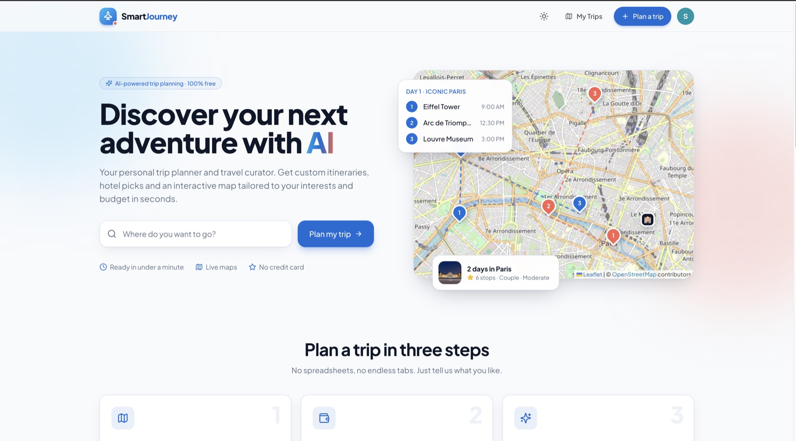
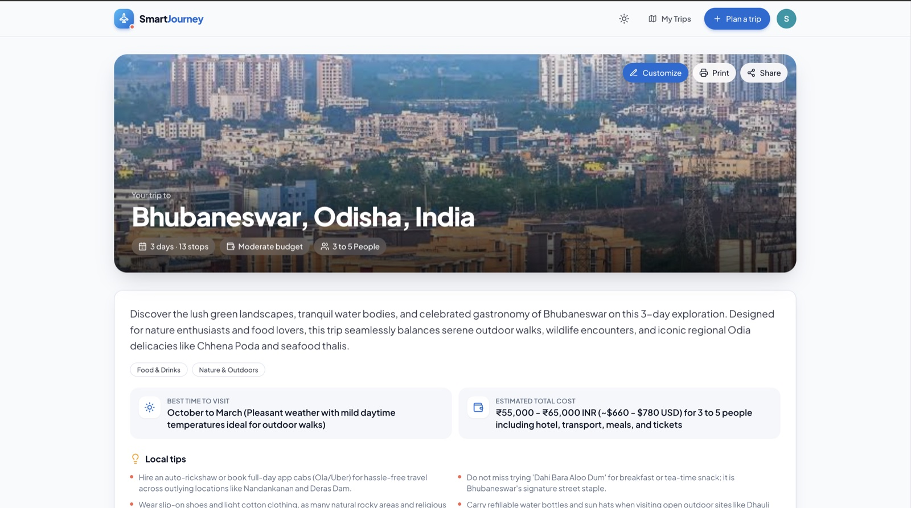
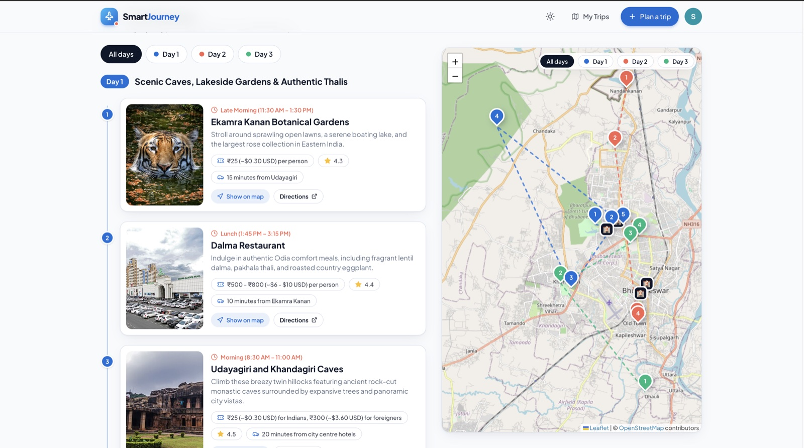

# SmartJourney · AI Travel Planner

Plan personalised trips with AI. Pick a destination, the number of days, your budget, who's travelling and what you love, and SmartJourney builds:

- a **day-by-day itinerary** with timings, ticket prices, ratings and travel times
- **hotel picks** that match your budget, with booking and Google Maps links
- an **interactive map** (OpenStreetMap + Leaflet) with numbered, colour-coded stops and routes per day
- a trip **overview** with best season, estimated cost and local tips

After generating, you can **customize** the plan: reorder or move stops between days, edit details, add your own places and notes, add or remove days and hotels, or ask the AI to **re-plan a single day** ("more street food, relaxed pace"). Trips are saved to **My Trips** and can be shared, printed, copied or deleted. Light and dark themes are included.



| Trip overview | Itinerary & interactive map |
| --- | --- |
|  |  |

## Tech stack

| Concern | Tool | Cost |
| --- | --- | --- |
| UI | React 18, Vite, Tailwind CSS, shadcn/ui (Radix), lucide icons | — |
| Itinerary generation | Google Gemini via `@google/genai` (structured JSON output) | Free tier |
| Destination search | [Photon](https://photon.komoot.io) (OpenStreetMap data) | Free, no key |
| Maps | [Leaflet](https://leafletjs.com) + OpenStreetMap tiles | Free, no key |
| Place photos | Wikipedia API | Free, no key |
| Sign-in | Firebase Authentication (Google + anonymous guests) | Free (Spark) |
| Storage | Firebase Firestore, with a localStorage copy | Free (Spark) |

The old Google Places API (which needs a billing account) has been removed completely.

## Getting started

```bash
npm install
cp .env.example .env    # then add your Gemini key
npm run dev             # http://localhost:5173
```

### Environment variables

| Variable | Required | Notes |
| --- | --- | --- |
| `VITE_GEMINI_API_KEY` | **Yes** | Free key from [Google AI Studio](https://aistudio.google.com/app/apikey). |
| `VITE_GEMINI_MODEL` | No | Defaults to `gemini-flash-latest`, with automatic fallback to other Flash models. |
| `VITE_FIREBASE_*` | Recommended | Web app config from the Firebase console. Enables Google sign-in and cloud sync. Without it the app runs in local-only guest mode. |

### Firebase setup

1. In the [Firebase console](https://console.firebase.google.com), add a **Web app** and copy its config into `.env`.
2. **Firestore** → Create database (production mode).
3. **Firestore → Rules**: paste the contents of [`firestore.rules`](firestore.rules) and publish
   (or `npx firebase-tools deploy --only firestore:rules`).
4. **Authentication → Sign-in method**: enable **Google** and **Anonymous**.
5. **Authentication → Settings → Authorized domains**: add your deployed domain (localhost is allowed by default).

Security model: users can only list, create and delete their own trips; anyone with a trip's (random UUID) link can view it, so sharing works.

> **Note:** this is a client-only app, so the Gemini key ships to the browser. Restrict the key to your domains in Google Cloud Console (*API key → Application restrictions → Websites*) before deploying publicly.

## Scripts

- `npm run dev` – start the dev server
- `npm run build` – production build into `dist/`
- `npm run preview` – preview the production build
- `npm run lint` – lint the code

## Project structure

```
src/
  App.jsx                     layout (header, footer, toaster, auth)
  main.jsx                    routes
  context/AuthContext.jsx     Firebase Google / anonymous guest sign-in
  context/ThemeContext.jsx    light / dark / system theme
  service/
    AIModel.js                Gemini prompt + JSON schema + model fallback
    GlobalApi.js              Photon search, Wikipedia photos, map links
    firebaseConfig.js         optional Firestore
    tripStore.js              save / load / delete trips (Firestore + localStorage)
  lib/trip.js                 normalises old and new trip formats
  components/
    custom/                   Header, Footer, Hero (home), Logo, PlaceImage, DestinationSearch, …
    component/                create-trip, trip page sections, TripMap, My Trips
  view-trip/[tripId]/         trip details page
```

## Deploying

`vercel.json` already rewrites all routes to `index.html`. Add the same `VITE_*` variables in your hosting provider's environment settings.

The OpenStreetMap tile servers are run by volunteers. They're fine for personal projects, but for heavy production traffic switch `TILE_URL` in `src/components/component/TripMap.jsx` to a hosted tile provider.
